# devskills workflow

These diagrams show how skills and `ds.py` commands work together from request to delivery, including safe testing, screenshots, dangerous operations, knowledge indexing, evidence aggregation, installation, and updates. Here, `ds.py` abbreviates `python3 <skill-directory>/scripts/ds.py`.

## 1. Task overview

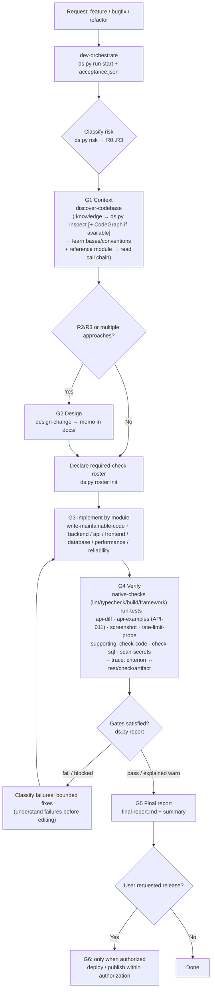

Risk follows side effects, not diff size:

| Level | Example | Minimum checks |
| --- | --- | --- |
| R0 | Text/comments | check-code, scan-secrets (+ native lint for code edits) |
| R1 | Local logic | + context map, units, native typecheck/framework, acceptance trace |
| R2 | API, DB, auth, cache, queue | + preflight, isolated DB integrations, native build (+ api-diff for spec changes, migration checks for model changes) |
| R3 | Money, batches, deletion, permissions | + decision memo, failure-path/simulator tests |

## 2. Skill activation

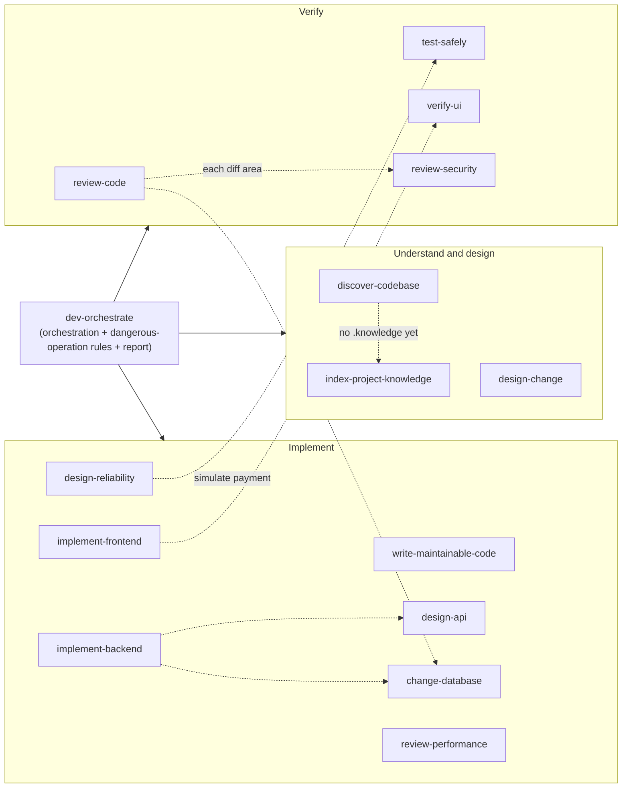

## 3. Safe testing (test-safely)

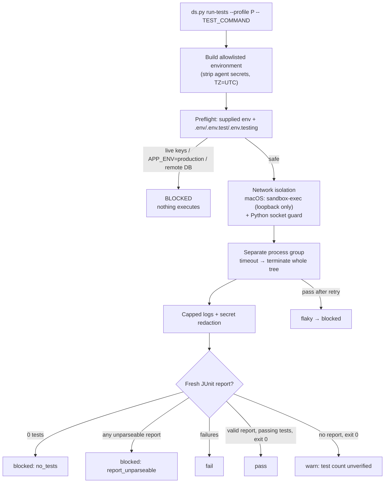

Dangerous effects always use simulators:

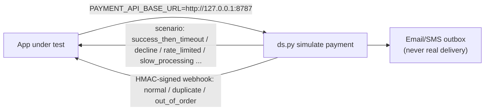

## 4. Screenshots and baselines (verify-ui)

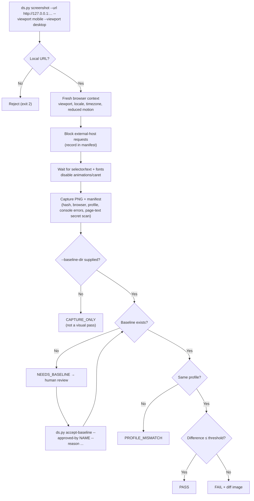

## 5. Confirm dangerous commands only on non-local servers

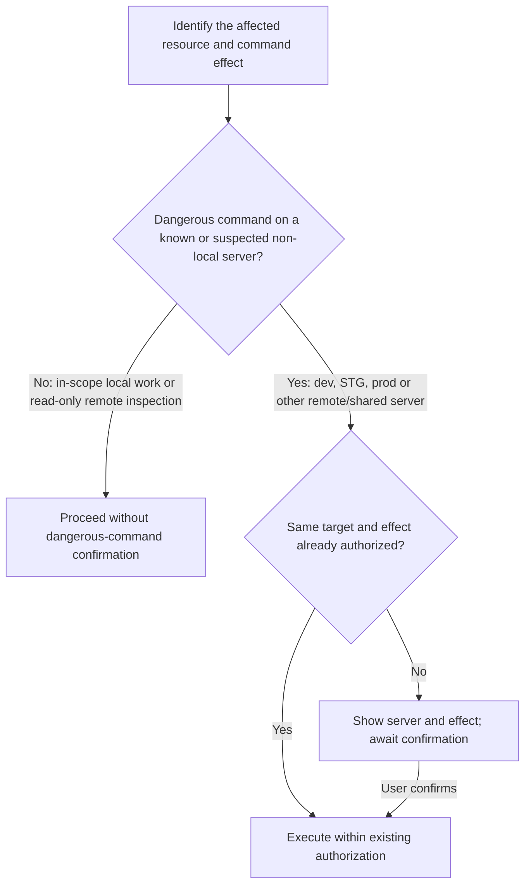

Judge the affected resource, including remote targets reached through SSH, Docker/Kubernetes contexts, cloud CLIs or localhost tunnels. Clarify the server before a dangerous step if concrete signs suggest a remote target. Existing user restrictions and task scope still apply. The automatic Bash guard hook and blanket permission `ask` rules remain retired. Remove old settings with `python3 agent-skills.py guard --remove`; unrelated settings remain intact. Authorization persists across commands and turns.

## 6. Knowledge index (index-project-knowledge)

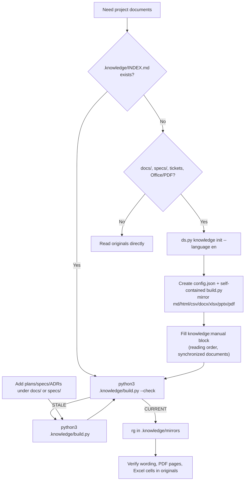

## 7. Evidence and reporting

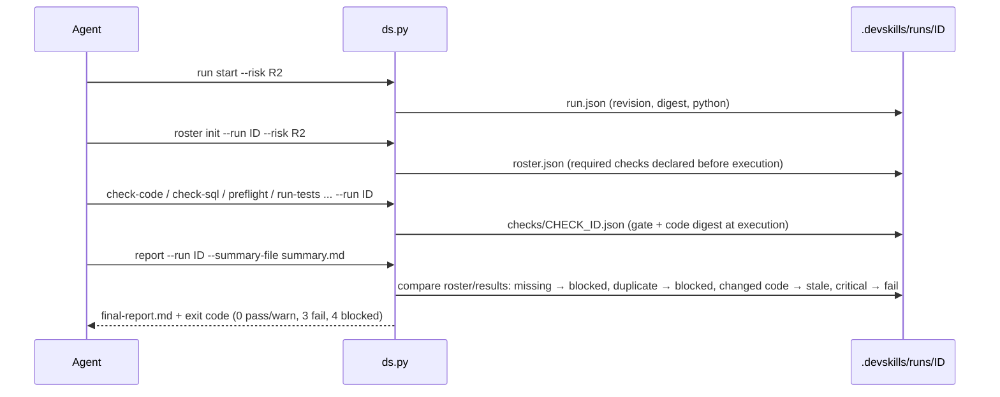

## 8. Installation, manual updates, rollback

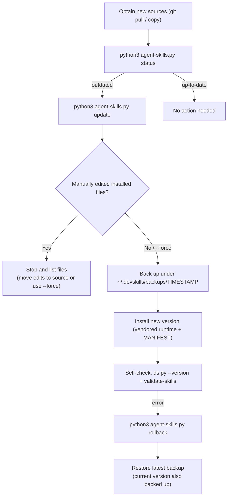

## 9. Project conventions and native evidence

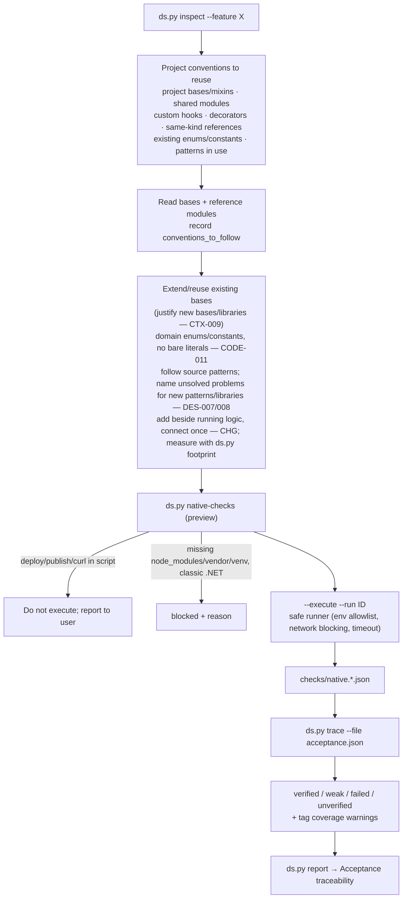

Debugging and refactoring:

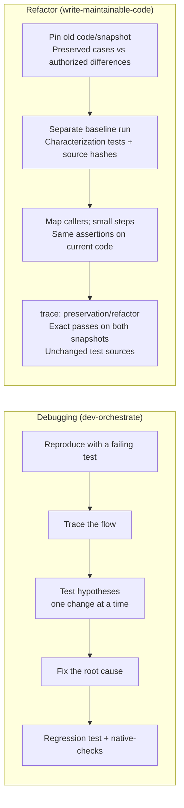

Maintenance and updates use the same preservation contract for behavior outside the requested change. Actual old code is the baseline; report spec/code discrepancies without silently changing behavior. `preservation`/`refactor` criteria link a separate baseline run, check and pinned source state; current-only passes cannot verify them. Bugfix `regression` criteria may intentionally fail on old code and remain separate. See [the baseline schema and limits](../skills/write-maintainable-code/references/refactoring-workflow.md#5-prove-it).
